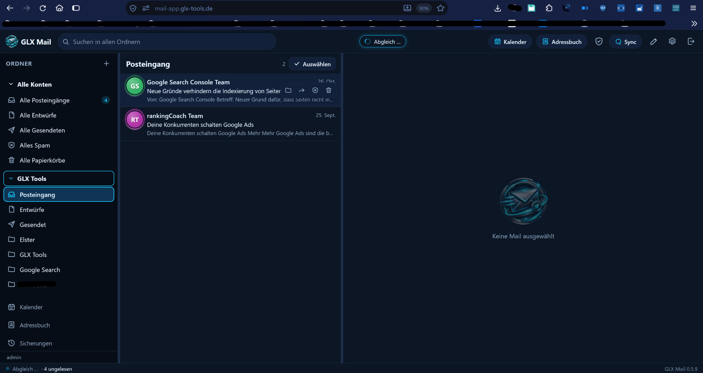
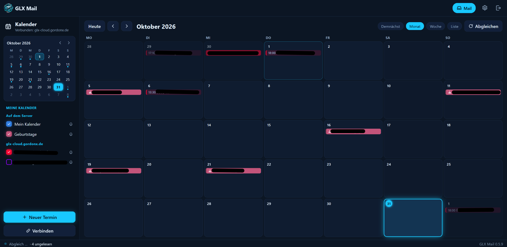

🌍 Sprachen: [🇺🇸 English](README.md) | [🇩🇪 Deutsch](README.de.md)

# ☁️ GLX Mail Postfach

### Ein gehostetes Postfach für E-Mails, Kontakte und Kalender ✉️

*Ein fertig gehosteter GLX-Mail-Dienst von GLX Tools. Du erhältst ein GLX-Mail-Postfach, verbindest externe E-Mail-Konten und führst Nachrichten, Kontakte und Kalender an einem Ort zusammen – ohne einen eigenen Server betreiben zu müssen.* ⚡

---

## ⬇️ GLX Mail Postfach beziehen

👉 **[GLX Tools – Postfach Registrieren](https://mail-app.glx-tools.de/registrieren.html)** — Hol dir jetzt dein Konto, wenn es dir gefällt, erwerbe eine Lizenz.

👉 **[GLX Tools – Shopübersicht](https://glx-tools.de/shopuebersicht/)** — Produktinformationen, 14-tägige Testphase und Jahreslizenz.

GLX Mail Postfach ist die gehostete Lösung für alle, die die GLX-Mail-Webanwendung nutzen möchten, aber keinen eigenen Linux-Server besitzen oder betreiben wollen.

---

## 📸 Übersicht & Screenshots

### 1️⃣ Mail-Ansicht

  

### 2️⃣ Kalender-Ansicht

  

---

## ✨ Funktionen

- ☁️ **Hosting durch GLX Tools:** Nutze die GLX-Mail-Webanwendung, ohne einen eigenen Linux-Server betreiben zu müssen.
- 📧 **GLX-Mail-Postfach:** Du erhältst ein E-Mail-Postfach von GLX Tools.
- 🔗 **Externe E-Mail-Konten:** Verbinde externe E-Mail-Konten und verwalte deren Nachrichten gemeinsam an einem Ort.
- 👥 **Adressbuch-Import:** Importiere Kontakte aus verschiedenen Quellen.
- 📅 **Vollständiger Kalender:** Verwende den integrierten Kalender und importiere Kalenderdaten aus verschiedenen Quellen.
- 🌐 **Zugriff per Browser:** Nutze die Webanwendung ohne Installation des Windows-Desktopprogramms.

---

## 🧪 Testphase & Lizenz

- **14 Tage kostenlose Testphase** – richte dein Postfach ein und teste die verfügbaren Funktionen.
- **Jahreslizenz: 24,90 € pro Jahr.**
- Nach Ablauf der Testphase wird die Synchronisierung deaktiviert, bis die Jahreslizenz erworben wurde.

---

## 🚀 Erste Schritte

1. Öffne die **[GLX Tools Shopübersicht](https://glx-tools.de/shopuebersicht/)**.
2. Starte die 14-tägige Testphase für GLX Mail Postfach.
3. Richte dein GLX-Mail-Postfach ein.
4. Verbinde die externen E-Mail-Konten, die du zentral verwalten möchtest.
5. Importiere deine Kontakte und Kalenderdaten aus den unterstützten Quellen.
6. Kaufe und aktiviere die Jahreslizenz, um die Synchronisierung nach der Testphase fortzusetzen.

---

## 🔗 Mehr zu diesem Produkt

👉 **[GLX Tools – Shopübersicht](https://glx-tools.de/shopuebersicht/)** — Produktbeschreibung, Testphase und Lizenz.

Support: **info@glx-tools.de**

---

## 📄 License

Copyright © 2026 GLX Tools – Gordon Lehmann.
All rights reserved.

GLX Mail is proprietary commercial software.
No open-source license is granted.

The software may only be used under the
applicable license purchased through GLX Tools.

This repository contains product documentation
and screenshots. All rights to these materials
are reserved by their respective copyright holders.

GLX Mail Postfach is a hosted commercial service from GLX Tools. The applicable usage rights are defined by the license purchased through the GLX Tools shop. This repository provides product documentation and screenshots.

---

Mit ❤️ erstellt von **Dreamdancer100**

